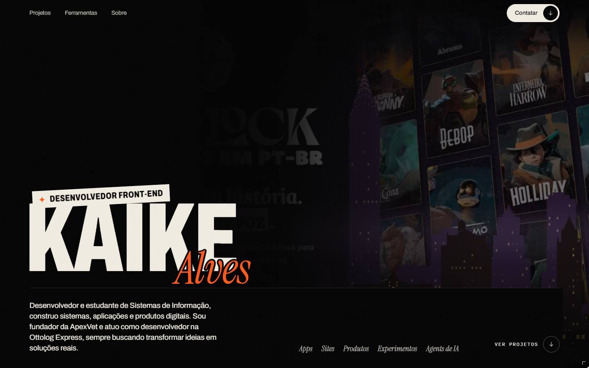
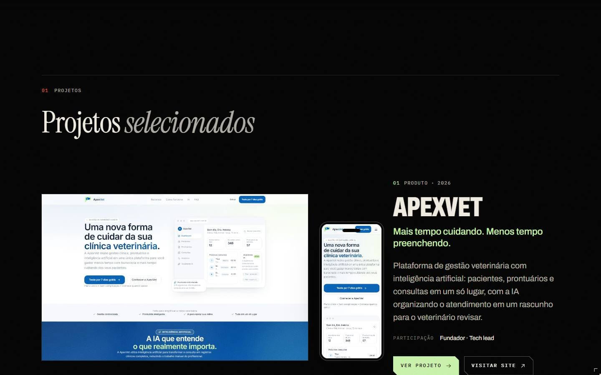
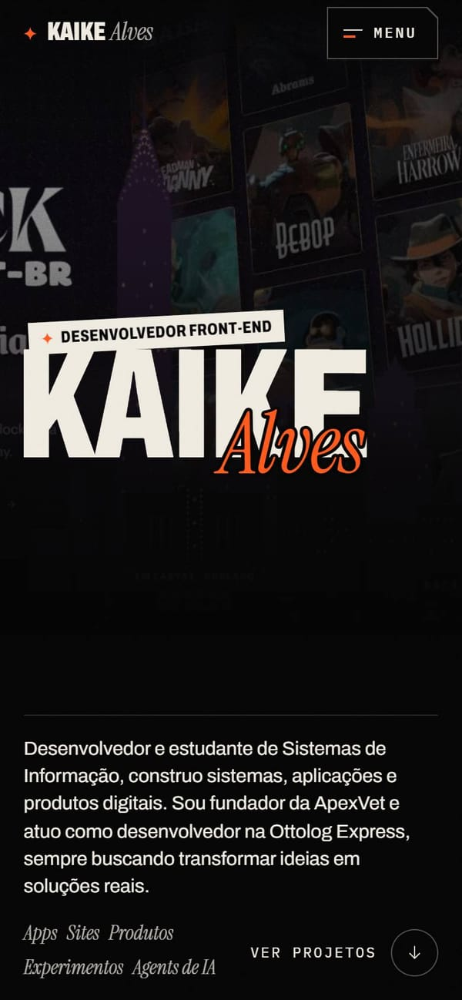
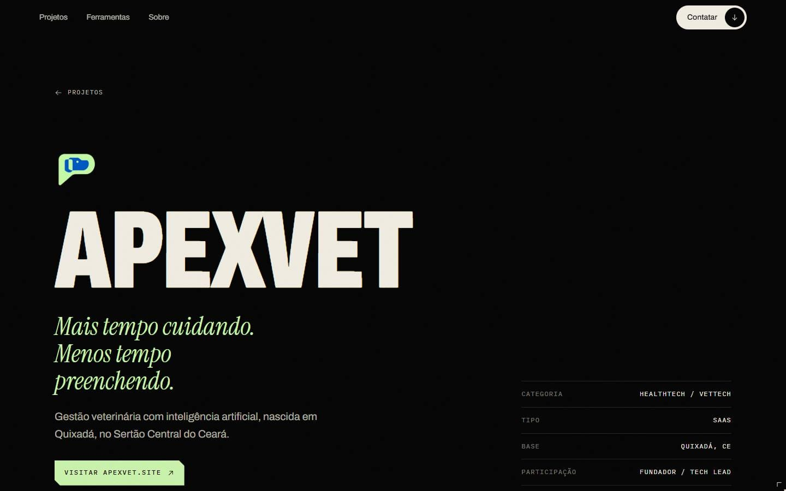

<div align="center">

# ✦ KAIKE *Alves*

**Portfólio pessoal** — desenvolvedor e estudante de Sistemas de Informação.<br>
Fundador da ApexVet · Desenvolvedor na Ottolog Express.

[](https://react.dev)
[](https://www.typescriptlang.org)
[](https://vite.dev)
[](https://motion.dev)

[LinkedIn](https://www.linkedin.com/in/kaikeferreiraalves) ·
[Instagram](https://www.instagram.com/kaike_alvesz/) ·
[GitHub](https://github.com/kaikehttps)

<br>



</div>

<br>

## Sobre o projeto

Um portfólio com cara de **sala de cinema**: fundo preto, tipografia grande e os projetos
passando atrás do nome como num trailer. A ideia é ser expressivo sem poluir — cada seção
tem espaço para respirar.

Sem backend, sem formulário, sem painel: é um site estático, rápido, e todo o conteúdo mora
em arquivos TypeScript fáceis de editar.

<table>
  <tr>
    <td width="68%"></td>
    <td width="32%"></td>
  </tr>
  <tr>
    <td colspan="2"></td>
  </tr>
</table>

## O que tem dentro

- **Abertura com movimento** — o nome reage ao mouse (eixos de largura e peso da fonte variável) e as capas dos projetos passam ao fundo em vídeo.
- **Projetos em vídeo** — cada projeto mostra o site ou app de verdade, rodando em loop só enquanto está na tela.
- **Página da ApexVet** — contada como uma história, do TCC ao produto, com um carrossel de fotos.
- **Skills em faixa contínua** — ícones das ferramentas que uso, rolando devagar e pausando no hover.
- **Currículo em PDF** — basta colocar o arquivo na pasta: a seção de download aparece sozinha.
- **Acessível** — respeita *movimento reduzido* e *economia de dados*, navegação por teclado com foco visível e textos alternativos nas imagens.
- **Leve** — imagens convertidas para AVIF/WebP no build, vídeos sob demanda e código dividido por página.

## Tecnologias

| | |
|---|---|
| **Base** | React 19, TypeScript (strict), Vite 7 |
| **Rotas** | React Router 7 |
| **Movimento** | Motion (LazyMotion), Lenis para a rolagem suave |
| **Estilo** | CSS Modules + tokens em variáveis CSS |
| **Imagens** | vite-imagetools + sharp (AVIF/WebP responsivos) |
| **Ícones** | Simple Icons |
| **Fontes** | Archivo (variável), Instrument Serif, IBM Plex Mono — via Fontsource |

## Rodando localmente

Precisa do **Node.js 20.19** ou mais novo.

```bash
npm install
npm run dev        # http://localhost:5180
```

| Comando | O que faz |
|---|---|
| `npm run dev` | servidor de desenvolvimento (mostra também os conteúdos de exemplo) |
| `npm run build` | checa os tipos e gera o site em `dist/` |
| `npm run preview` | serve o build em http://localhost:4180 |
| `npm run typecheck` | só a checagem de tipos |

## Estrutura

```
src/
├── content/        textos, projetos, ferramentas, currículo e redes  ← edite aqui
├── assets/
│   ├── projects/   imagens e vídeos de cada projeto (uma pasta por projeto)
│   └── curriculo/  o PDF do currículo
├── sections/       seções da página inicial (Hero, Projetos, Skills, Currículo, Sobre, Contato)
├── pages/          página inicial, página de projeto, página da ApexVet, 404
├── layout/         navegação, menu do celular, cursor, abertura e transições
├── components/     peças visuais reutilizáveis
├── lib/            hooks, rolagem suave, imagens e movimento
└── styles/         tokens (cores, tipografia, espaçamento) e estilos globais
```

Todo o conteúdo do site fica em [`src/content/`](src/content/). O passo a passo para adicionar
projetos, trocar textos ou o currículo está em [`docs/COMO-EDITAR.md`](docs/COMO-EDITAR.md), e as
regras visuais em [`docs/DIRECAO-DE-ARTE.md`](docs/DIRECAO-DE-ARTE.md).

## Publicação

É um site estático: qualquer hospedagem serve. Na **Vercel**, o [`vercel.json`](vercel.json) já
redireciona as rotas (`/projetos/...`) para o app e deixa os arquivos de `assets/` em cache longo.

Com o domínio definido, preencha `VITE_SITE_URL` no `.env` (ex.: `https://seudominio.com`) e gere o
build de novo — assim a imagem de prévia (`public/og.jpg`) aparece certinha no LinkedIn e no WhatsApp.

## Uso

O código está aberto para consulta e estudo — fique à vontade para se inspirar.
Os textos, as imagens, os vídeos e as marcas dos projetos (ApexVet, Ottolog Express, Projeto Celeste
e os demais) pertencem aos seus donos e **não** devem ser reutilizados.

<br>

<div align="center">
<sub>Feito por Kaike Alves</sub>
</div>
